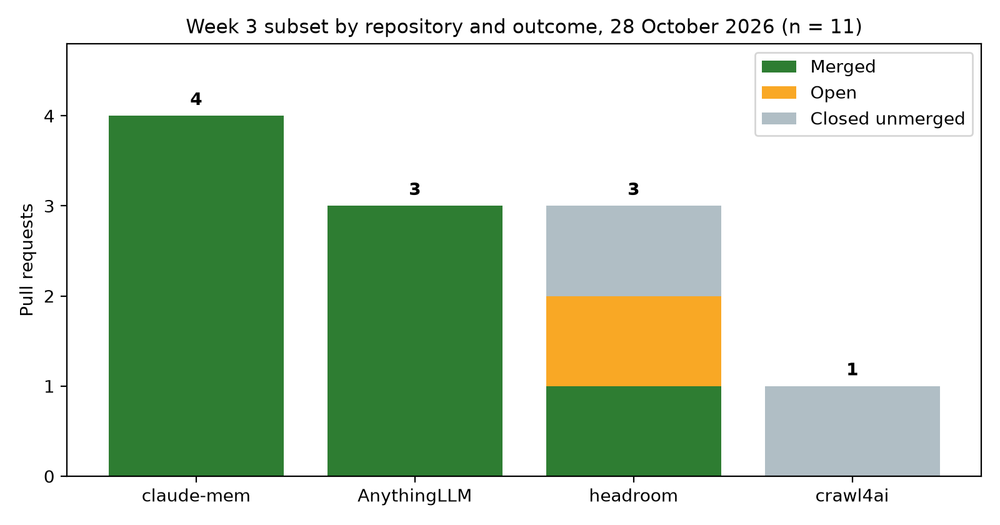
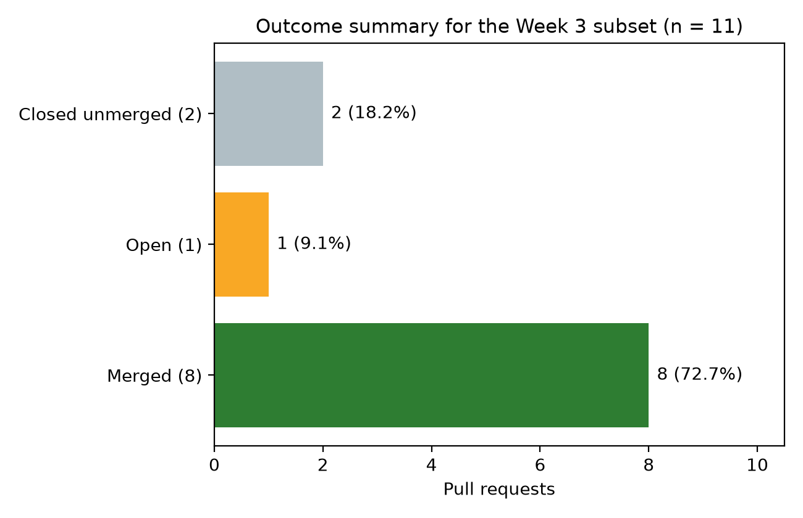
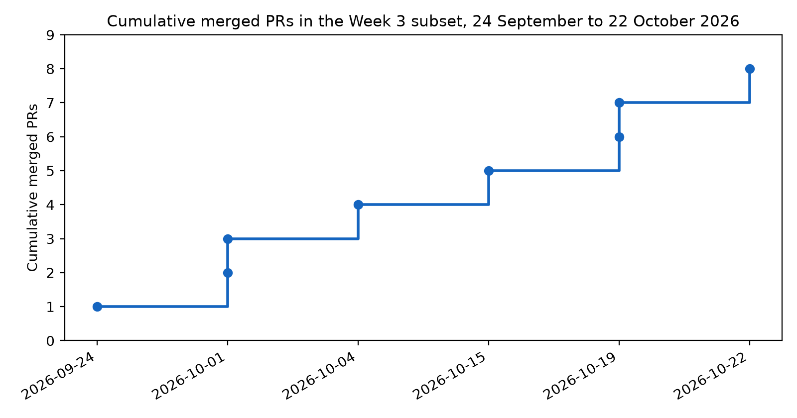

## Download the paper (PDF)

[](https://github.com/rtmalikian/llm-tooling-agent-infra-quiet-failures/raw/main/week3-llm-tooling-agent-infra.pdf)

### 👉 [**Click here to download the PDF**](https://github.com/rtmalikian/llm-tooling-agent-infra-quiet-failures/raw/main/week3-llm-tooling-agent-infra.pdf)

One click, no sign-up, no paywall.

---

# When Agent Plumbing Fails Quietly: A Retrospective Analysis of Open-Source Contributions to LLM Tooling and Agent Infrastructure

Raphael T. Malikian, MBBS BSc (Hons) — Independent Researcher, Palmdale, California, USA — ORCID 0009-0008-4326-4205

Submitted to Computer Methods and Programs in Biomedicine (Manuscript CMPB-D-26-08971). Preprint: Zenodo, https://doi.org/10.5281/zenodo.23741622.

---

**Running head:** WHEN AGENT PLUMBING FAILS QUIETLY

**Author:** Raphael T. Malikian, MBBS BSc (Hons)

**Affiliation:** Independent Researcher, Palmdale, California, USA

**Corresponding author:** Raphael T. Malikian. Email: rtmalikian@gmail.com. GitHub: github.com/rtmalikian

**ORCID:** 0009-0008-4326-4205

**Article type:** Retrospective observational study with reflective practice analysis

**Keywords:** large language models; AI agents; tool use; model context protocol; open-source software; pull requests; software reliability; clinical AI infrastructure

**Author background, in brief.** The author trained in medicine in the United Kingdom and completed family medicine residency training in the United States. He later bootstrapped a direct primary care clinic and ran it as chief executive. He now builds clinical artificial intelligence tools and contributes code to open-source health and AI projects. His earlier peer-reviewed work includes a four-station knee simulator study published in 2013 [18]. This paper covers the layer underneath the agent: the memory stores, tool bridges, approval screens, and crawlers that a clinical agent stands on.

---

## Abstract

**Background.** Clinical AI is moving from single-prompt chat to agents that keep memory across sessions, call tools, send mail, schedule jobs, and crawl sources. The tools that do that work are open source, and outside contributors write part of them. A failure in this layer rarely crashes loudly. It drops rows, mislabels an error, hides the content under approval, or invents digits, and the agent keeps running.

**Purpose.** This study describes one contributor's pull requests (PRs) to LLM tooling and agent infrastructure, reports what merged and what did not, and asks what the pattern says about silent failure in agent software.

**Methods.** The data source was the author's public GitHub record, extracted with the GitHub REST API on 28 October 2026 (search: author:rtmalikian, type:pr). The full record held 223 PRs. This paper analyses the LLM tooling and agent infrastructure subset: 11 PRs in 4 repositories. Each PR was classed as merged, open, or closed unmerged. All 11 PRs were read in full, including their public descriptions.

**Results.** Eight of the 11 subset PRs merged, 1 remained open, and 2 closed unmerged. Among the 10 resolved PRs, the merge share was 80.0%. Merges concentrated in two projects: claude-mem (4 of 4) and AnythingLLM (3 of 3). The merged work fixed one silent data-loss path that had left about 19,000 rows unindexed, one approval screen that hid the very content under approval, one error classifier that parked a provider for 30 minutes over a 60-second rate limit, and one credential lookup that could never succeed on a standard Linux install. The two closed PRs each fixed a real defect. Closure is not a quality verdict.

**Conclusions.** Agent infrastructure fails by omission more than by crash. The merged fixes share one shape: they make a hidden state visible, or they stop the code from stating as fact something it only guessed. That shape is the paper's claim. A clinical agent built on this layer inherits every quiet failure in it, so the layer deserves the same audit habit that clinical software already expects for records and doses: show the content, name the guess, and never report completion for work that never ran.

---

## 1. Introduction

A language model on its own can only talk. Give it tools and it can act, and that is where the risk moves. Toolformer showed a model can teach itself to call simple APIs and do better for it [2]. ReAct interleaved reasoning traces with tool actions, so a model could check a fact instead of inventing one [1]. Retrieval-augmented generation gave models an outside source to read before answering [3], and chain-of-thought prompting gave them a way to work a problem step by step [4]. Voyager pushed the same idea into a long-lived agent with a skill library that grew across sessions [5]. Each step made the model more useful, and each step added a new place where the system could fail without saying so.

Medicine felt that shift early. Reviews of large language models in medicine in 2023 described tools already deployed in clinical, educational, and research settings with mixed results [6]. Models that encode clinical knowledge scored well on exam-style questions [7], and later work measured how far that performance falls when the same models face real clinical decisions [16]. The gap between exam performance and bedside performance is, in part, a plumbing gap. An agent that summarises a chart, books a follow-up, or pulls a guideline needs memory that does not drop rows, tool calls that do not misfire, and approval screens that show what is being approved. None of that is glamorous. All of it decides whether the agent is safe to use.

The four projects in this subset cover that plumbing. Claude-mem gives coding agents a persistent memory store, so a session can pick up where the last one stopped. AnythingLLM is a workspace where agents use tools, including email and scheduled jobs, behind an approval step. Headroom compresses and prices long agent contexts, deciding what survives when a conversation is too long for a model window. Crawl4ai fetches web pages for agents under a page budget. A defect in any of them is a defect in the agent's senses or its memory.

Open-source review shapes what gets fixed. Pull-based development puts the contributor's change in front of maintainers who weigh technical quality beside social signals [8, 10]. Contributors report that slow or absent feedback is a real barrier [9, 17], and newcomers learn a project's norms partly by having changes accepted or refused [11]. Machine learning systems carry a special kind of technical debt: the code around the model, the data pipelines, the configuration, and the glue that holds them together [12]. Agent systems add a second layer of glue: the tool bridge, the memory store, and the approval flow. Software engineering for machine learning already warned that the surrounding system, not the model, is where most of the work and most of the failure sits [13]. This paper tests that warning against 11 real PRs.

### 1.1 Purpose of the Paper

Papers in this series divide one contributor's record by domain. Earlier papers covered clinical natural language processing, medical imaging, vector databases and retrieval, and FHIR and clinical data infrastructure. This paper covers the next domain in the queue: LLM tooling and agent infrastructure. It is the smallest subset in the series so far, and the one with the highest merge share among resolved PRs. That combination, small and mostly accepted, is worth a close read. It says something about what maintainers accept quickly, and about which failures a contributor can spot from outside a project.

The paper asks three questions.

**RQ1.** What did the merged contributions in the LLM tooling and agent infrastructure subset actually fix, stated in operational terms?

**RQ2.** Why did 8 of 10 resolved PRs merge here, when other domains in the series resolved lower, and what do the 2 closures show about the limits of that reading?

**RQ3.** Which failure shape repeats across these projects, and what should a clinical agent builder check first when adopting this layer?

## 2. Methods

### 2.1 Data source and extraction

Data came from the GitHub REST API search endpoint on 28 October 2026, using the query `author:rtmalikian type:pr`. The search returned a total count of 223 PRs in the author's public record. Repository names, PR numbers, titles, states, and merge or closure dates came from the API response, and each PR in the subset was then fetched individually to confirm its merged flag, addition and deletion counts, and changed-file counts. PR descriptions quoted or paraphrased in Section 3.2 come from the public PR pages themselves. Any reader can repeat the search and compare counts.

### 2.2 Subset definition

The subset was defined by repository function before any counting. A PR entered the subset if its target repository was an LLM agent memory store, an agent workspace with tool use, an agent context and pricing tool, or a web crawler built for agent retrieval. Four repositories met the rule: thedotmack/claude-mem, Mintplex-Labs/anything-llm, headroomlabs-ai/headroom, and unclecode/crawl4ai. The subset held 11 PRs. Clinical text processing, imaging, retrieval, and FHIR work falls outside the rule and appears in the other papers of this series.

### 2.3 Status definitions

A PR was coded **merged** if the API recorded a merge timestamp, **closed unmerged** if its state was closed with no merge timestamp, and **open** if it was open at extraction. The merge share among resolved PRs is merged divided by merged plus closed unmerged. Open PRs are excluded from that share, and the paper says so wherever the number appears. An open PR is a censored observation. It may merge next week.

### 2.4 Case selection

All 11 PRs were read in full. There was no sampling, and no PR was dropped for being inconvenient. Section 3.2 groups the cases by failure shape rather than by repository, because the same shape appears in more than one project. The two closed PRs get the same treatment as the merged ones. A results section that reports only wins would teach nothing.

### 2.5 Contribution workflow under study

The workflow behind these PRs was fixed in advance. The defect had to be reproduced locally before a fix was written. Tests had to pass locally before the PR opened. The repository's own PR template outranked the author's habits. Every commit carried a Developer Certificate of Origin sign-off. Corrections went in as new commits on the same branch; history was never rewritten by force-push. When a maintainer request could be read two ways, the author asked one clarifying question and waited.

### 2.6 Ethics

This study used public software records only. It involved no patient data, no clinical records, and no private messages. Reporting follows the spirit of the STROBE and RECORD statements for observational work on routinely collected data [14, 15].

## 3. Results

### 3.1 The subset in numbers

The subset held 11 PRs in 4 repositories. Eight merged (72.7% of the subset), 1 was open at extraction (9.1%), and 2 had closed unmerged (18.2%). Among the 10 resolved PRs, the merge share was 80.0%. Across the subset, the PRs added 2,561 lines and removed 205 lines across 45 changed files. Creation dates ran from 21 September 2026 to 22 October 2026, and merged dates from 24 September 2026 to 22 October 2026. Table 1 gives the split by repository. Figure 1 shows the same split. Figure 2 summarises the subset outcome. Figure 3 shows merged PRs accumulating across the five-week window.

The merges piled up in two places. Claude-mem accepted all 4 PRs sent to it, and AnythingLLM accepted all 3. Headroom merged 1 of its 3, with 1 still open and 1 closed. Crawl4ai's single PR closed unmerged. Two repositories therefore produced 7 of the 8 merges. That concentration matters for RQ2: the subset rate is high because two maintainers said yes to everything, not because every project in the subset behaved the same way.

**Table 1.** Pull requests in the LLM tooling and agent infrastructure subset, by repository and status at 28 October 2026.

| Repository | PRs | Merged | Open | Closed unmerged |
|---|---:|---:|---:|---:|
| thedotmack/claude-mem | 4 | 4 | 0 | 0 |
| Mintplex-Labs/anything-llm | 3 | 3 | 0 | 0 |
| headroomlabs-ai/headroom | 3 | 1 | 1 | 1 |
| unclecode/crawl4ai | 1 | 0 | 0 | 1 |
| **Total** | **11** | **8** | **1** | **2** |

**Figure 1.** Pull requests by repository and outcome at 28 October 2026. Claude-mem and AnythingLLM accepted everything sent to them. Headroom and crawl4ai account for every non-merge in the subset.



**Figure 2.** Outcome summary for the LLM tooling and agent infrastructure subset at 28 October 2026. Merged PRs are the large majority, and the open PR is a single case.



**Figure 3.** Cumulative merged PRs in the subset, 24 September to 22 October 2026. Merges arrived steadily across the window, not in one burst.



### 3.2 Case studies

#### 3.2.1 Memory that drops rows, and a test that guards the shipped bundle

Claude-mem PR #4823 fixed the worst failure in the subset, and the PR description states the scale plainly. After a wiped collection, the sync bootstrap found no stored ids, set its watermark to zero, and recorded an empty pending list. Live syncs then advanced the watermark past rows that were still waiting in the backfill queue, and the query that drives backfill never visited them again. About 19,000 rows sat unindexed while the log claimed "Backfill check complete". The fix tracks every unindexed source id as pending when bootstrap finds no stored ids for a kind, instead of tracking nothing. The lesson is stark. A memory store that reports completion for work it never did is worse than one that fails loudly, because every later answer built on that memory inherits the gap, and no error ever points back to it.

Claude-mem PR #4217 guards the same project from a different angle. It adds a contract test for the OpenCode plugin's generated bundle, building the shipped artifact with the project's own build config and asserting that it exports exactly one functional default export. A source-level test already pinned the source module, but a bundler can introduce a fault that the source test cannot see. The test exists because a plugin that fails to load gives the agent no memory at all, and the failure looks like a user error until someone reads the bundle.

#### 3.2.2 Errors mislabelled, and credentials looked up in the wrong place

Claude-mem PR #4243 fixed an error classifier that cost a provider 29 idle minutes at a time. On the Gemini free tier, a per-minute 429 clears in about 60 seconds, but the classifier read the gRPC status name for every 429 and labelled it quota exhaustion, which triggered a fixed 30-minute cooldown. The fix checks the HTTP status first, reads the quota failure details to separate a true daily quota from a per-minute limit, and honours the retry delay the provider returns. The bug was a branch-order bug: the general check ran before the specific one, so the specific branch could never fire. Error labels are not decoration in agent software. They decide how long a tool stays down, and a wrong label is a denial of service the system inflicts on itself.

Claude-mem PR #4369 fixed a credential lookup that could never succeed on a standard Linux install. The worker queried libsecret for Claude Code credentials, but Claude Code on Linux stores its credentials in a JSON file under the user's Claude config directory, never in libsecret. Every SDK spawn therefore logged a misleading warning about a keychain source that was never authoritative, and the worker's token-expiry and quota checks never saw the real credential. The fix consults the on-disk file after a keychain miss, parses it with the same logic as the keychain path, and drops the warning to debug level when the file is present. A lookup that asks the wrong store is not a minor logging fault. It blinds the quota and expiry checks that keep an agent from failing mid-task.

#### 3.2.3 Approval screens, tool bridges, and prices that must say what they are

AnythingLLM PR #6732 fixed an approval screen that hid the content under approval. Approval requests for email tools and scheduled jobs passed the email body, CC and BCC recipients, and the job prompt to the tool, but never put them in the approval card's payload. An approver was asked to approve a message he could not read and a job whose prompt he could not see. The fix puts the body, recipients, and prompt in the payload. Human approval is only a safety control if the human can see what is being approved. A card that omits the content is a signature line with the document missing.

AnythingLLM PR #6805 fixed a tool bridge that marked a healthy server dead. Servers that do not implement the optional Model Context Protocol ping method answer with a JSON-RPC "method not found" error, and the server list code treated that error as a connectivity failure. The whole server went unavailable even though initialisation, tool listing, and tool calls all worked. The fix treats that specific error as proof the server is alive, since a valid JSON-RPC error reply can only come from a live server, while transport errors and timeouts still mark a server down. The distinction is the whole point: an error reply is evidence of life, and code that cannot tell the two apart will keep switching off tools that work.

AnythingLLM PR #6780 fixed a default with a shutdown date attached. The OpenAI image generator defaulted to a model that OpenAI was shutting down on 23 October 2026. Any install that never set a model preference would have silently lost image generation on that date. The fix moves the default to the replacement model. Defaults are decisions made on behalf of every user who never touches a setting, and a default that points at a dead model is a silent outage scheduled in advance.

Headroom PR #3692, the one headroom merge in the subset, fixed a disclosure gap in context compression. The smart crusher silently truncated long scalar arrays to a maximum item count and emitted no marker at all: valid output, no sentinel, sibling count fields untouched. That contradicts the project's own stated principle that user and assistant content is never dropped silently. The fix appends a marker naming how many items were dropped, with a hash that lets the full original array be retrieved from the project's store. Compression that hides its own cuts is a quiet rewrite of the conversation. A marker that names the cut restores the reader's chance to notice.

Headroom PR #3825, still open at extraction, applies the same honesty rule to pricing. Unknown-model usage priced with a default tier is now warned about once and flagged as estimated, with price provenance carried through the client and the proxy ledger. A price stated as exact when it is a guess is a billing fact built on air. The PR is large, carries conflict and rebase labels, and has drawn 11 comments plus 20 review comments. It is the subset's longest-running conversation, and its open state is a review story, not a rejection.

#### 3.2.4 Numbers invented, and pages fetched past the budget

Headroom PR #3741 closed unmerged, and it fixed a real defect. A spreadsheet loader converted cell values with a plain integer cast, and above 2^53 an IEEE-754 double cannot represent consecutive integers, so the cast rendered the double's exact value instead of the number the user typed. The PR description gives the example: 123456789012345678 renders as 123456789012345680. That text goes to an agent, where a fabricated identifier reads as exact. The fix bounded the cast to the exactly representable range and let larger values fall through to the float form, signalling approximation honestly. The closure does not change the defect. It shows that a correct fix can still lose to timing, scope, or a competing change, and that a closed PR is weak evidence about code quality.

Crawl4ai PR #2383 closed unmerged, and it also fixed a real defect. The best-first crawl strategy computed a budget-aware batch size for its final batch and then filled the batch with a fixed-size loop, so a crawl capped at 12 pages fetched 21 pages and silently dropped the 9 over-budget results. The fix makes the filling loop use the budget-aware count. An agent that asks for 12 pages and gets 12 results has no way to know 21 pages were fetched, and a budget that the code ignores is not a budget. Both closed PRs share a shape with the merged ones: a quiet overstatement, corrected by making the code say what it actually did.

## 4. Discussion

### 4.1 The repeating shape: quiet overstatement

Seven of the 11 PRs fix a case where the software stated, implied, or logged something stronger than the truth. The sync log claimed completion for rows never indexed. The approval card implied the approver had seen the content. The error classifier stated quota exhaustion for a rate limit. The credential lookup implied a keychain was authoritative on a platform that never used it. The compression output implied nothing had been cut. The spreadsheet loader stated an exact integer that was never typed. The crawler implied it honoured a budget it overshot. The remaining PRs guard against the same shape from the other side: a bundle test that checks the shipped artifact, a default that points at a live model, a ping check that reads an error reply as evidence, and a price flag that names a guess as a guess.

That shape is the paper's answer to RQ3. Agent plumbing fails by omission and by overstatement, not by crash, because the agent keeps running past the failure and builds later answers on it. A dropped memory row changes the next summary. A hidden approval changes who is responsible for a sent mail. A fabricated identifier changes a lookup. The clinical version of this failure is easy to picture: an agent that summarises a chart from a memory store with a gap, or that books a follow-up from a tool result it mislabelled, will present its output with the same confidence as a correct one. The fix in every case here was not a new model. It was a sentence, a marker, a flag, or a branch order that made the hidden state visible.

### 4.2 Why the merge share ran high, and why that reading needs care

The 80.0% merge share among resolved PRs is the highest in this series, and the reason is visible in Table 1. Two projects accepted everything, and they account for 7 of the 8 merges. Small, concrete, reproduction-backed fixes with tests are the easiest changes for a maintainer to say yes to, and the claude-mem and AnythingLLM PRs fit that shape: each names a failing case, a root cause, and a bounded change. The two closures sit in the other two projects, where review ran longer or the change competed with other work. Headroom's open PR shows the same review pressure in slow motion, with conflicts, rebase labels, and a long comment thread.

Three cautions apply. First, the subset is small. If the one open PR closes unmerged, the resolved share falls from 80.0% to 72.7%; if it merges, the share rises to 81.8%. Second, the open PR is excluded from the share, so the final figure will move when it resolves. Third, merged is not the same as used. This study did not track whether merged fixes reached releases or changed any running system. The honest claim is narrower: in this window, in these four projects, small fixes to silent failures were accepted at a high rate by two maintainers, and the failures themselves were real whether or not the PR merged.

### 4.3 Habits that kept waits from becoming disputes

The headroom open PR is the subset's longest wait, and it stayed a technical conversation. The habits from Section 2.5 did the work. Each PR opened with a reproduced defect and a named root cause, so a maintainer could argue with the reasoning instead of guessing at the symptom. Corrections went in as new commits, so a reviewer who had read the branch once could read the delta the second time. When a request could be read two ways, the author asked and waited rather than guessing in public. At crawl4ai, a one-comment closure ended a real fix without a dispute, and the fix stands in the public record for the next contributor to pick up. That is how a contributor keeps working in a project after a closure: leave the reasoning readable, and do not refile the same change in new clothing.

### 4.4 Limits

This is one contributor, one platform, one extraction date. The author is also the subject, which cuts both ways: he has the thread history and the motives, and he has an interest in his own record. The counts are platform facts and can be checked by any reader. The explanations in Section 4.1 and 4.2 cannot be checked the same way, and they should be weighted as interpretation. One PR was still open at extraction, so the final merge share will move from the resolved figure of 80.0%. The subset covers four projects chosen by function, not by sampling, so nothing here generalises to agent software as a whole. The paper also makes no claim about patient outcomes. No clinical deployment was studied, and the clinical reading in Section 4.1 is an implication for builders, not evidence from a trial.

## 5. Conclusions

The LLM tooling subset is small, mostly accepted, and unified by one failure shape. Memory that drops rows, approval cards that hide content, error labels that misstate the fault, credentials looked up in the wrong store, compression that hides its cuts, numbers invented past the representable range, and budgets overshot in silence: each of these lets an agent proceed as if the truth were stronger than it is. The merged fixes did not add features. They made hidden states visible, or they stopped the code from stating as fact something it only guessed.

I keep contributing to this layer anyway. Models get replaced every year. The memory stores, tool bridges, and approval flows stay, and the failures in them stay with every agent built on top. Work that lands there stays landed.

### 5.1 Future Work

Three follow-ups are practical. The first is a prospective multi-contributor replication: recruit contributors from several agent infrastructure projects, log submissions and outcomes as they happen, and test whether the quiet-overstatement shape appears in other contributors' records or is an artefact of one author's choice of defects. Retrospective self-study can raise the hypothesis. It cannot carry it.

The second is a release-tracking study. Merged is not used, and the next step is to follow each merged fix in this subset into a tagged release, then check whether downstream agent deployments picked that release up. A fix that merges but never ships helps no user, and the gap between merge and release is a measurable part of the pipeline.

The third is a disclosure audit of agent tools. Take a sample of agent workspaces and crawlers, and test each one for the seven quiet failures in Section 4.1: does the approval screen show the full content, does the memory store report gaps, does the error label separate rate limits from quota exhaustion, does the budget bind, does the price flag name its guesses, does the compressor disclose its cuts, and does the loader refuse to invent digits? The audit method is dull. The findings would not be.

## Declarations

**Funding.** None. This work received no grant or sponsor support.

**Conflicts of interest.** The author declares no conflicts of interest and no industry affiliations of any kind. The author is an independent researcher.

**Data availability.** Every pull request analysed here is public at github.com/rtmalikian. A snapshot of the dataset extracted on 28 October 2026, with repository names, PR numbers, states, and merge or closure dates, is deposited with the published version of this paper.

**Ethics.** This study is not human-subjects research. It used public software records only and involved no patient data.

**AI assistance.** An AI tool was used for literature searching, drafting support, and editing. The author reviewed the full text, verified the counts against the GitHub API extraction of 28 October 2026, and takes full responsibility for the content.

**Author contributions.** The author designed the study, extracted and coded the data, selected the cases, and wrote the paper.

## References

1. Yao S, Zhao J, Yu D, Du N, Shafran I, Narasimhan K, et al. ReAct: synergizing reasoning and acting in language models. In: Proceedings of the 11th International Conference on Learning Representations (ICLR 2023). 2023.
2. Schick T, Dwivedi-Yu J, Dessi R, Raileanu R, Lomeli M, Hambro E, et al. Toolformer: language models can teach themselves to use tools. Adv Neural Inf Process Syst. 2023;36:68539-68551.
3. Lewis P, Perez E, Piktus A, Petroni F, Karpukhin V, Goyal N, et al. Retrieval-augmented generation for knowledge-intensive NLP tasks. Adv Neural Inf Process Syst. 2020;33:9459-9474.
4. Wei J, Wang X, Schuurmans D, Bosma M, Xia F, Chi E, et al. Chain-of-thought prompting elicits reasoning in large language models. Adv Neural Inf Process Syst. 2022;35:24824-24837.
5. Wang G, Xie Y, Jiang Y, Mandlekar A, Xiao C, Zhu Y, et al. Voyager: an open-ended embodied agent with large language models. Adv Neural Inf Process Syst. 2023;36.
6. Thirunavukarasu AJ, Ting DSJ, Elangovan K, Gutierrez L, Tan TF, Ting DSW. Large language models in medicine. Nat Med. 2023;29(8):1930-1940.
7. Singhal K, Azizi S, Tu T, Mahdavi SS, Wei J, Chung HW, et al. Large language models encode clinical knowledge. Nature. 2023;620(7956):172-180.
8. Gousios G, Pinzger M, van Deursen A. An exploratory study of the pull-based software development model. In: Proceedings of the 36th International Conference on Software Engineering (ICSE 2014). New York: ACM; 2014. p. 345-355.
9. Gousios G, Zaidman A, Storey MA, van Deursen A. Work practices and challenges in pull-based development: the contributor's perspective. In: Proceedings of the 38th International Conference on Software Engineering (ICSE 2016). New York: ACM; 2016. p. 285-296.
10. Tsay J, Dabbish L, Herbsleb J. Influence of social and technical factors for evaluating contribution in GitHub. In: Proceedings of the 36th International Conference on Software Engineering (ICSE 2014). New York: ACM; 2014. p. 356-366.
11. Steinmacher I, Silva MAG, Gerosa MA, Redmiles DF. A systematic literature review on the offerings of newcomers to open source software projects. Inf Softw Technol. 2015;59:412-422.
12. Sculley D, Holt G, Golovin D, Davydov E, Phillips T, Ebner D, et al. Hidden technical debt in machine learning systems. In: Advances in Neural Information Processing Systems 28 (NeurIPS 2015). Montreal: Curran Associates; 2015. p. 2503-2511.
13. Amershi S, Begel A, Bird C, DeLine R, Gall H, Kamar E, et al. Software engineering for machine learning: a case study. In: Proceedings of the 41st International Conference on Software Engineering: Software Engineering in Practice (ICSE-SEIP 2019). Montreal: IEEE/ACM; 2019. p. 291-300.
14. von Elm E, Altman DG, Egger M, Pocock SJ, Gotzsche PC, Vandenbroucke JP, et al. The Strengthening the Reporting of Observational Studies in Epidemiology (STROBE) statement: guidelines for reporting observational studies. Lancet. 2007;370(9596):1453-1457.
15. Benchimol EI, Smeeth L, Guttmann A, Harron K, Moher D, Petersen I, et al. The REporting of studies Conducted using Observational Routinely-collected health Data (RECORD) statement. PLoS Med. 2015;12(10):e1001885.
16. Hager P, Jungmann F, Holland R, Bhagat K, Hubrecht I, Knauer M, et al. Evaluation and mitigation of the limitations of large language models in clinical decision-making. Nat Med. 2024;30(9):2613-2622.
17. Marlow J, Dabbish L, Herbsleb J. Impression formation in online peer production: activity traces and personal profiles in GitHub. In: Proceedings of the 2013 Conference on Computer Supported Cooperative Work (CSCW 2013). New York: ACM; 2013. p. 117-128.
18. Malikian R, et al. Development of a four-station knee wear simulator and preliminary results. J Bioeng Biomed Sci. 2013;3(2). doi:10.4172/2155-9538.1000125.

---

## How to cite

Malikian, R.T. (2026). When Agent Plumbing Fails Quietly: A Retrospective Analysis of Open-Source Contributions to LLM Tooling and Agent Infrastructure. GitHub. https://github.com/rtmalikian/llm-tooling-agent-infra-quiet-failures

```bibtex
@misc{malikian2026agentplumbing,
  author = {Malikian, Raphael T.},
  title = {When Agent Plumbing Fails Quietly: A Retrospective Analysis of Open-Source Contributions to LLM Tooling and Agent Infrastructure},
  year = {2026},
  publisher = {GitHub},
  url = {https://github.com/rtmalikian/llm-tooling-agent-infra-quiet-failures}
}
```

## Dataset

The dataset for this paper is [week3_pr_dataset.csv](week3_pr_dataset.csv): the 11 pull requests in the LLM tooling and agent infrastructure subset (thedotmack/claude-mem, Mintplex-Labs/anything-llm, headroomlabs-ai/headroom, unclecode/crawl4ai), extracted from the GitHub API on 28 October 2026, with repository, PR number, title, status, creation and merge or closure dates, comment counts, additions, deletions, changed files, and the PR URL for each record.

## Open-Source Clinical AI Research Series

Part of the Open-Source Clinical AI Research Series by [Raphael T. Malikian](https://github.com/rtmalikian):

- [Clinical NLP and de-identification](https://github.com/rtmalikian/clinical-nlp-deidentification-open-source)
- [Medical imaging and DICOM reliability](https://github.com/rtmalikian/medical-imaging-dicom-open-source-reliability)
- [Vector databases and retrieval for clinical AI](https://github.com/rtmalikian/vector-databases-rag-clinical-ai-infrastructure)
- [FHIR and health data infrastructure](https://github.com/rtmalikian/fhir-health-data-infrastructure-open-source)
